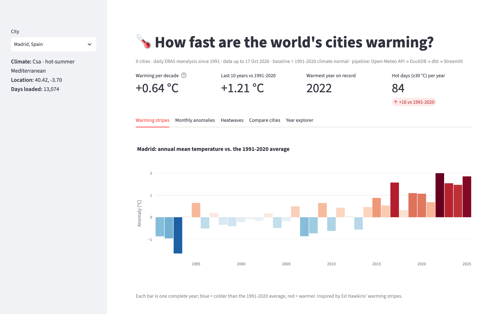
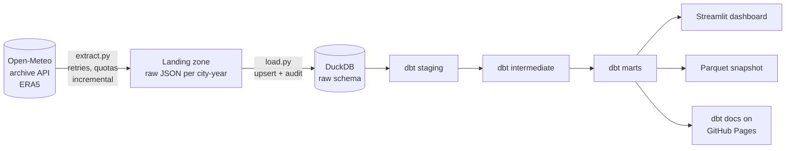
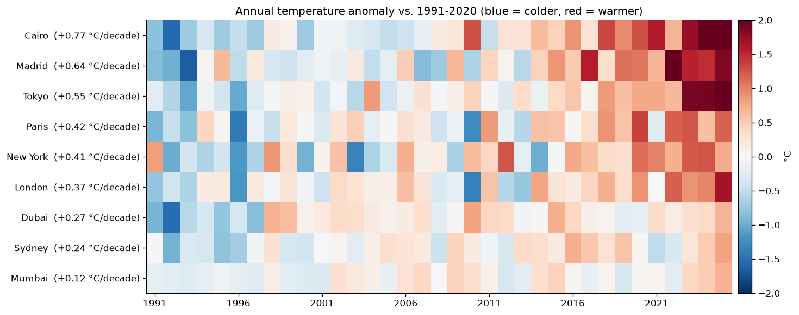
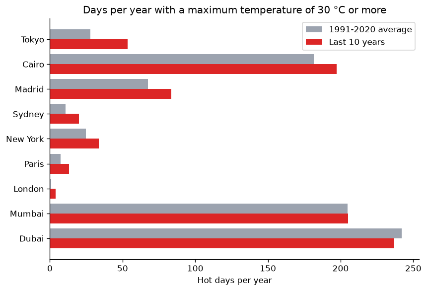
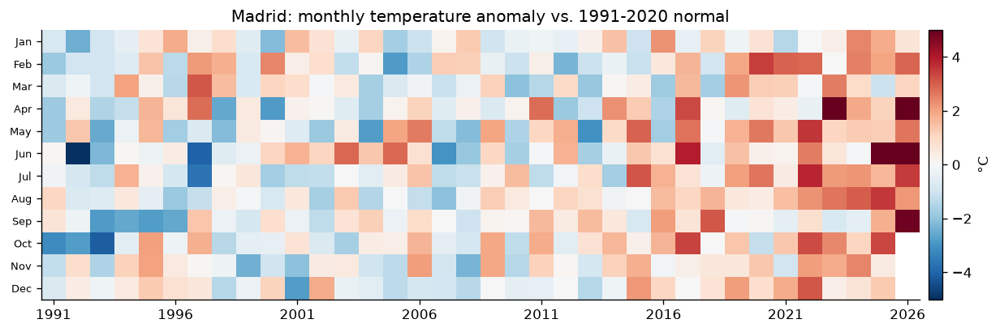

# Climate ELT Pipeline

[](https://github.com/fareszid/weather-data-pipeline/actions/workflows/ci.yml)

[](LICENSE)

How much warmer are world cities today than during the 1991-2020 climate normal?

This pipeline pulls daily weather for 9 cities since 1991 from the Open-Meteo API into a
file-based landing zone, loads it into DuckDB, models and tests it with dbt, and shows the
results in a Streamlit dashboard. The dbt documentation and lineage graph are published at
**[fareszid.github.io/weather-data-pipeline](https://fareszid.github.io/weather-data-pipeline/)**.

**Findings** (1991 to October 2026, 117,666 city-days): every city is warming. Cairo leads at
**+0.77 °C per decade**, then Madrid (+0.64) and Tokyo (+0.55). The average city now spends
**36 days a year in a heatwave, up from 17** in 1991-2020, and 58 of the 90 "top-10 warmest
years" across the nine cities fell in 2016-2025. Tokyo's days at 30 °C or more went from 28 to
53 per year.



## Architecture



| Step | What it does | Code |
|---|---|---|
| Extract | One request per city and year, saved unchanged as `landing/city=…/year=….json`. Complete years are never downloaded again, so a daily run costs one request per city. 429/5xx errors are retried with backoff; when the free quota runs out the run stops and the next one picks up where it left off. | [`extract.py`](src/weatherpipe/extract.py) |
| Load | Files are upserted into `raw.daily_weather` on (city, date), so loading twice never duplicates rows. Days ERA5 hasn't published yet are skipped and counted, and each file is logged in `raw.load_audit`. | [`load.py`](src/weatherpipe/load.py) |
| Transform | dbt staging → intermediate → marts. The daily fact table is incremental: only rows loaded since the last run are processed. | [`dbt/`](dbt) |
| Test | 41 dbt tests: keys, ranges, relationships, accepted values, and custom checks (Tmin ≤ Tmax, no gaps in any city's daily series, no future dates, heatwaves never overlap). | [`_marts.yml`](dbt/models/marts/_marts.yml), [`dbt/tests`](dbt/tests) |
| Serve | Streamlit + Plotly dashboard. The marts are also exported to Parquet so the app can run without the warehouse. | [`dashboard/app.py`](dashboard/app.py) |

## Data model

| Model | Grain | Contents |
|---|---|---|
| `stg_open_meteo__daily_weather` | city × day | Renamed columns, °C / mm / hours, load metadata |
| `stg_cities` | city | Tracked cities (the same seed drives the extractor) |
| `int_daily_weather_enriched` | city × day | Hot day (≥ 30 °C), tropical night (≥ 20 °C), frost day, wet day, weather group |
| `int_monthly_weather` | city × month | Monthly aggregates and a completeness flag |
| `fct_daily_weather` | city × day | Incremental fact table |
| `dim_cities` | city | Location, Köppen climate, data coverage |
| `mart_climate_normals` | city × calendar month | 1991-2020 normals and the 90th-percentile Tmax used for heatwaves |
| `mart_monthly_anomalies` | city × month | Temperature anomaly (°C) and precipitation anomaly (%) |
| `mart_heatwaves` | heatwave | 3+ days in a row above the local threshold (gaps-and-islands SQL) |
| `mart_annual_summary` | city × year | Climate indicators, anomaly, warmth rank, heatwave days |
| `mart_warming_trends` | city | °C per decade trend, last 10 years vs. the baseline |

The baseline period and the heatwave length are dbt `vars`, so the analysis can be re-run with
another reference period, e.g. `--vars '{baseline_start_year: 1981, baseline_end_year: 2010}'`.

## Results

| City | Climate | Trend (°C/decade) | Last 10 years vs. 1991-2020 | Days ≥ 30 °C per year (1991-2020 → last 10 y) | Warmest year |
|---|---|---|---|---|---|
| Cairo | hot desert | **+0.77** | +1.30 °C | 181 → 197 | 2024 |
| Madrid | Mediterranean | **+0.64** | +1.21 °C | 68 → 84 | 2022 |
| Tokyo | humid subtropical | **+0.55** | +1.02 °C | 28 → 53 | 2025 |
| Paris | oceanic | +0.42 | +0.72 °C | 7 → 13 | 2020 |
| New York | humid subtropical | +0.41 | +0.81 °C | 25 → 34 | 2024 |
| London | oceanic | +0.37 | +0.73 °C | 1 → 4 | 2025 |
| Dubai | hot desert | +0.27 | +0.21 °C | 242 → 237 | 2010 |
| Sydney | humid subtropical | +0.24 | +0.29 °C | 11 → 20 | 2025 |
| Mumbai | tropical monsoon | +0.12 | +0.11 °C | 205 → 205 | 2025 |







The coastal cities closest to the tropics warm the slowest (Mumbai +0.12, Dubai +0.27 °C per
decade), probably because the sea moderates them. Madrid and Tokyo warm more than twice as fast
as Dubai.

## Dashboard

```bash
make dashboard        # streamlit run dashboard/app.py
```

Five tabs: warming stripes, monthly anomaly heatmap, heatwaves (days per year and longest
events), a comparison of all cities, and a year-by-year view against the normal. Without a local
warehouse the app reads the Parquet snapshot in `dashboard/data/`, so it can be deployed as is
on Streamlit Community Cloud.

## Run it

```bash
git clone https://github.com/fareszid/weather-data-pipeline.git
cd weather-data-pipeline
python -m venv .venv && source .venv/bin/activate
make install          # pip install -e ".[dashboard,dev]"
make run              # extract -> load -> dbt seed + build
make dashboard
```

The first run backfills 35 years for 9 cities (324 requests). Open-Meteo's free tier counts
requests by the amount of data, so the backfill hits the hourly quota after about 210 requests.
The pipeline then stops, and running `make run` an hour later continues from there. After the
backfill, each run only downloads the current year.

```bash
weatherpipe extract --cities london,paris --start 2020-01-01   # a subset
weatherpipe transform                                           # dbt only
make test                                                       # 16 tests, including a dbt build
```

To track another city, add a line to [`dbt/seeds/cities.csv`](dbt/seeds/cities.csv). The
extractor and the models both read it.

## Tests

- **Unit tests**: year chunking, payload validation, retries and backoff, quota handling,
  incremental extraction, idempotent loading. They use a fake HTTP session, no network.
- **dbt integration test**: loads real API responses (2 cities × 3 years, committed as
  fixtures), runs `dbt seed` and `dbt build`, checks the marts, checks that every heatwave day
  is above its threshold, and that an incremental re-run adds no duplicates.
- **Dashboard test**: renders the Streamlit app headlessly from the Parquet snapshot.
- **CI** runs everything on each push. A second workflow builds the dbt docs site.

## Project structure

```
├── src/weatherpipe/      # extract, load, CLI, README figures
├── dbt/
│   ├── models/           # staging / intermediate / marts + schema tests
│   ├── tests/            # custom data tests
│   ├── macros/           # generic tests, weather code mapping, schema naming
│   └── seeds/cities.csv  # tracked cities
├── dashboard/            # Streamlit app + Parquet snapshot of the marts
├── tests/                # pytest suite and real API fixtures
└── docs/figures/         # images used in this README
```

## Limitations and next steps

- ERA5 describes a grid cell of roughly 10-25 km around each city centre, not a weather station,
  so urban heat-island effects are partly smoothed out.
- A linear trend over 35 years depends on the start and end years. The R² of each trend is kept
  in `mart_warming_trends`.
- Next: a scheduler (Dagster or Airflow) for daily runs, alerts on test failures and source
  freshness, and more cities.

## Data

Weather data by [Open-Meteo.com](https://open-meteo.com/) (ERA5 / ERA5-Land reanalysis from the
Copernicus Climate Change Service), licensed CC BY 4.0. The test fixtures contain a small
excerpt of API responses.
